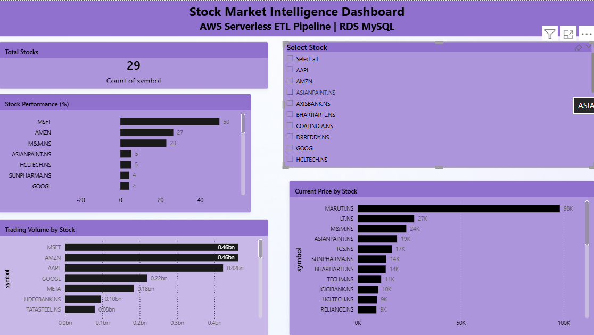

# 📈 Serverless Stock Market Intelligence ETL Pipeline

## Overview

This project is a serverless ETL pipeline built on AWS that automatically fetches stock market data, transforms it, and loads it into an Amazon RDS MySQL database for analysis and visualization.

## Architecture

Yahoo Finance API
→ AWS Lambda (Extract)
→ Amazon S3 (Raw)
→ AWS Lambda (Transform)
→ Amazon S3 (Processed)
→ AWS Lambda (Load)
→ Amazon RDS (MySQL)
→ AWS Step Functions

## Tech Stack

- AWS Lambda
- Amazon S3
- Amazon RDS (MySQL)
- AWS Step Functions
- Python
- Boto3
- PyMySQL
- Git & GitHub

## Features

- Fetches real-time stock market data
- Stores raw data in Amazon S3
- Cleans and transforms data
- Loads processed data into Amazon RDS
- Serverless ETL workflow
- Step Functions orchestration
- Easy to extend with EventBridge scheduling

## Project Structure

```
Serverless-Stock-Market-Intelligence/
│
├── lambda/
│   ├── extract/
│   ├── transform/
│   └── load/
│
├── sql/
│   └── create_table.sql
│
├── docs/
│
├── README.md
└── requirements.txt
```

## Workflow

1. Extract stock market data using Yahoo Finance API
2. Store raw JSON data in Amazon S3
3. Transform and clean the data
4. Save processed data back to Amazon S3
5. Load processed data into Amazon RDS
6. Execute the complete workflow using AWS Step Functions

## Power BI Dashboard

The project includes an interactive Power BI dashboard connected to Amazon RDS MySQL.



## Future Improvements

- EventBridge Scheduler
- CloudWatch Monitoring
- Power BI Dashboard
- SNS Notifications
- Infrastructure as Code (Terraform)

## Author

**Yashashwani Singh**

B.Tech Artificial Intelligence & Data Science
